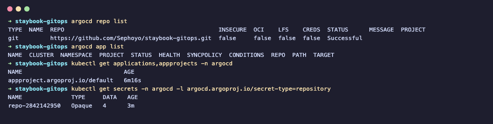
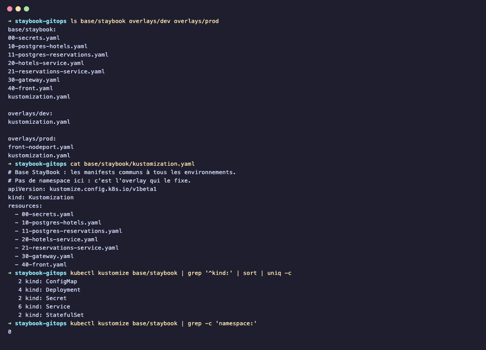
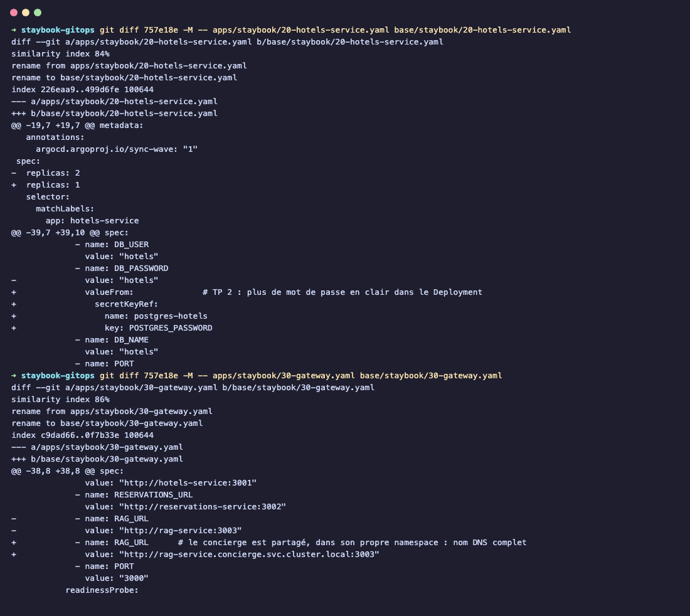
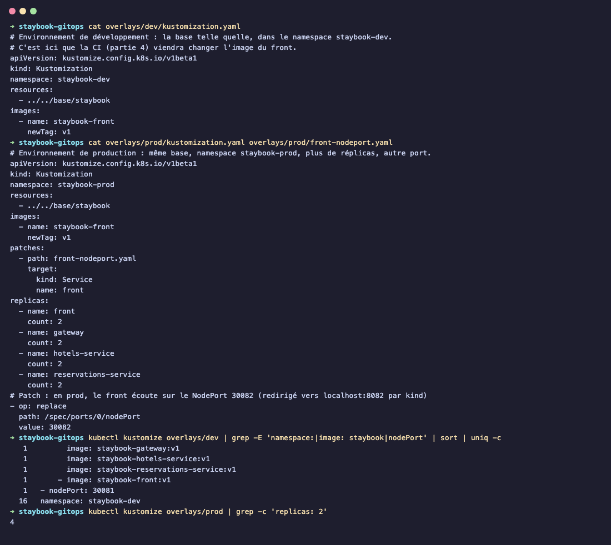
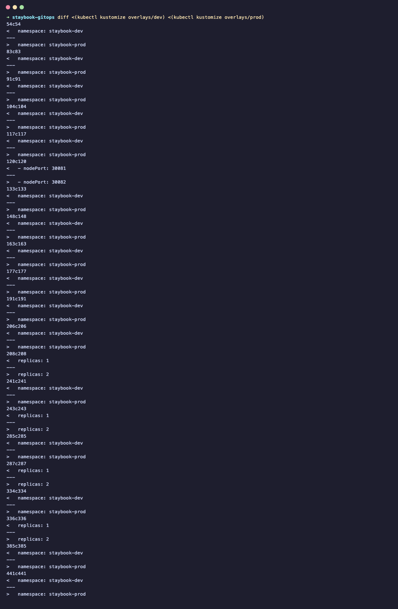
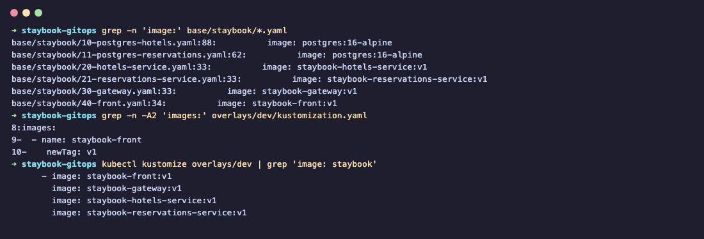

# Réponses — TP 2 : StayBook en production avec Argo CD

**Nom(s) :** Joseph Baert  
**Dépôt GitHub :** https://github.com/Sephoyo/staybook-gitops  

Les captures montrent les sorties réelles des commandes, lancées depuis le dépôt `staybook-gitops` (dossier [`captures/tp2/`](captures/tp2/)).


## Étape 1 — Repartir d'un cluster propre

### Question 1

_Comparez `kind-config.yaml` avec celui du TP 1. Qu'est-ce qui a été ajouté, et pourquoi la prod ne peut-elle pas réutiliser le NodePort 30081 de dev, alors qu'elle sera dans un autre namespace ?_


**Ajouté :** une troisième redirection de port, `containerPort: 30082` → `hostPort: 8082`, pour le front de **prod**. On a donc 8080 pour Argo CD, 8081 pour dev et 8082 pour prod. Les commentaires ont aussi été mis à jour (« StayBook dev »).

**Pourquoi pas 30081 pour la prod :** un **NodePort est une ressource du cluster entier, pas d'un namespace**. Le port est ouvert sur **chaque nœud**, par kube-proxy, et un port donné ne peut renvoyer que vers **un seul** Service. Les namespaces isolent les **noms** des objets, pas les ports réseau des nœuds. Un second Service qui demanderait `nodePort: 30081` serait refusé par l'API server (`provided port is already allocated`). Il faut donc un autre NodePort (30082), et donc une autre redirection kind (8082).


### Question 2

_Tout ce que vous aviez configuré dans Argo CD au TP 1 a disparu avec le cluster : le dépôt, les deux Applications, leur politique de sync. Listez ce qui, dans votre configuration Argo CD, vivait dans le cluster et non dans Git. À la fin de ce TP, cette liste sera réduite à deux éléments : lesquels, à votre avis ?_



Juste après la réinstallation, seul le dépôt (redéclaré à la main) existe, et aucune Application. Au TP 1, vivaient **uniquement dans le cluster** :
- la **déclaration du dépôt** et son **token** : le Secret `repo-…`, créé par `argocd repo add` ;
- les **Applications** `staybook` et `concierge`. Leur YAML était dans Git, mais c'est le `kubectl apply` manuel qui les créait. La **politique d'auto-sync** n'était prise en compte qu'après un nouvel apply à la main ;
- le **projet** `default`, créé automatiquement par l'installation ;
- le **mot de passe admin** (`argocd-initial-admin-secret`) et les sessions de la CLI ;
- l'**historique des syncs** (`argocd app history`) ;
- l'installation d'Argo CD elle-même. Sa recette est dans Git (`argocd-install/`), mais il faut l'appliquer à la main.

**À la fin du TP**, il ne restera que **deux éléments** hors de Git :
1. **le Secret du dépôt**, c'est-à-dire l'identifiant d'accès à GitHub : un mot de passe ne se commite pas ;
2. **l'Application racine `root`**, le seul `kubectl apply -f argocd/root.yaml`, l'amorce de l'App of Apps.

Tout le reste (projets, Applications, politiques de sync, contrôleur Sealed Secrets) sera décrit dans Git et créé par `root`. La clé privée Sealed Secrets restera elle aussi dans le cluster, mais exprès : elle ne doit jamais aller dans Git.


## Étape 2 — Un dépôt, deux environnements

### Question 3

_La base ne mentionne aucun namespace. Pourquoi est-ce voulu ? Qui le fixera, et à quel moment ?_



La base produit 16 objets (2 ConfigMap, 4 Deployment, 2 Secret, 6 Service, 2 StatefulSet) et **0** ligne `namespace:`.

C'est voulu : la base contient **ce qui est commun à tous les environnements**. Un namespace écrit en dur dans la base enverrait dev et prod au même endroit. On ne pourrait plus réutiliser la base pour deux environnements dans le même cluster.

C'est l'**overlay** qui le fixe, avec `namespace: staybook-dev` ou `namespace: staybook-prod` dans son `kustomization.yaml`. Kustomize l'ajoute alors à **tous** les objets au moment du **rendu**, quand on lance `kubectl kustomize` ou, dans le cluster, quand le **repo-server d'Argo CD** génère les manifests à chaque refresh, avant de les comparer au cluster. Le namespace de destination de l'Application (`--dest-namespace`) doit correspondre à cette valeur.


### Question 4

_Comparez `base/staybook/20-hotels-service.yaml` avec sa version du TP 1 : le bloc `DB_PASSWORD` a changé. Qu'est-ce qui a changé, et pourquoi était-ce indispensable avant la partie 3 ? Même question pour `RAG_URL` dans `30-gateway.yaml`._



**`DB_PASSWORD`** : au TP 1, le mot de passe était écrit **en clair dans le Deployment** (`value: "hotels"`). Au TP 2, il est **lu dans le Secret** `postgres-hotels`, clé `POSTGRES_PASSWORD`, via `valueFrom.secretKeyRef`.

C'était indispensable avant la partie 3 : on va remplacer le Secret en clair par un **SealedSecret chiffré**. Si le mot de passe restait aussi écrit en dur dans le Deployment, il resterait lisible dans Git et chiffrer le Secret ne servirait à rien. Avec `secretKeyRef`, le Secret devient la **seule source** du mot de passe : la base Postgres et le service qui s'y connecte lisent la même valeur. (Le `replicas: 2 → 1` du diff vient de la Q 8.1 du TP 1 : la base revient à 1, c'est l'overlay prod qui monte à 2.)

**`RAG_URL`** : `http://rag-service:3003` devient **`http://rag-service.concierge.svc.cluster.local:3003`**. Le concierge n'est plus dans le même namespace que le site : il est seul, dans le namespace `concierge`, et partagé par dev et prod. Un nom court ne se résout que dans le namespace du pod, il faut donc le **nom DNS complet** (on y revient en partie 2).


### Question 5

_Listez tout ce que `diff` montre entre dev et prod. Pour chaque différence, trouvez la ligne de `overlays/prod/kustomization.yaml` (ou du patch) qui la produit._





| Différence montrée par `diff` | Ligne qui la produit |
|---|---|
| `namespace: staybook-dev` devient `staybook-prod` sur **tous** les objets (16) | `namespace: staybook-prod` dans `overlays/prod/kustomization.yaml` |
| `nodePort: 30081` devient `30082` sur le Service `front` | `patches: - path: front-nodeport.yaml` (cible `kind: Service, name: front`) → dans le patch : `op: replace`, `path: /spec/ports/0/nodePort`, `value: 30082` |
| `replicas: 1` devient `2` sur `front`, `gateway`, `hotels-service`, `reservations-service` (4 Deployments) | le bloc `replicas:` ajouté en 1.3 (`- name: front / count: 2`, etc.) |

L'image n'apparaît pas dans le diff : les deux overlays ont le même bloc `images: - name: staybook-front / newTag: v1`.


### Question 6

_Dans le bloc `images:`, que désigne `name: staybook-front` ? Dans quel fichier de la base cette valeur apparaît-elle ? Si l'on ajoute `newName: ghcr.io/<login>/staybook-front` sous ce `name`, quelle ligne de quel manifest change ?_



`name: staybook-front` est le **nom de l'image à rechercher**, sans son tag, dans tous les conteneurs des manifests. Ce n'est pas le nom d'un Deployment. Kustomize remplace chaque `image:` dont le nom est `staybook-front`, quel que soit l'objet.

Cette valeur apparaît dans **`base/staybook/40-front.yaml`** : `image: staybook-front:v1`, dans le conteneur `front` du Deployment `front`.

Avec `newName: ghcr.io/Sephoyo/staybook-front` (et `newTag: <tag>`), c'est **la ligne `image:` du Deployment `front`** qui change dans le rendu : `image: staybook-front:v1` devient `image: ghcr.io/Sephoyo/staybook-front:<tag>`. **Le fichier de la base n'est pas modifié** : seul l'overlay change. C'est exactement ce que fera la CI en partie 4 : elle réécrira `newName`/`newTag` dans `overlays/dev/kustomization.yaml`, sans toucher à la base ni à la prod.


### Question 7

_Pourquoi ne pas avoir mis les deux StatefulSets PostgreSQL à 2 réplicas ? (Deux raisons : l'une concerne le volume, l'autre PostgreSQL lui-même.)_

1. **Le volume** : un StatefulSet crée **un PVC par réplica** grâce à `volumeClaimTemplates` (`data-postgres-hotels-0`, `data-postgres-hotels-1`). Le second pod démarrerait sur un **volume vide, à lui**, rejouerait le script d'init et aurait sa propre copie, différente, des données. Les deux pods ne partagent rien. Et le Service répartirait les requêtes entre eux au hasard : une réservation écrite sur l'un serait introuvable sur l'autre.
2. **PostgreSQL lui-même** : ce n'est pas un service sans état. Deux instances ne peuvent pas écrire sur les mêmes fichiers, et Postgres ne se réplique pas tout seul. Il faut une configuration **primaire / réplicas** (réplication en streaming, bascule en cas de panne), en général gérée par un opérateur (CloudNativePG, Zalando, Patroni). Augmenter `replicas` ne suffit pas.

Ajouter des réplicas ne marche que pour les services **sans état** (front, gateway, hotels, reservations), dont toutes les copies sont interchangeables.


### Question 8

_L'historique du TP 1 est toujours là, sous le nouveau commit. Pourquoi est-ce précieux pour un dépôt GitOps ? Citez une question qu'un auditeur pourrait poser et à laquelle `git log` répond._

```
593b5de feat: v2 — base/overlays, App of Apps, projets
757e18e docs: ajout du nom
3fa6d76 docs: preuves finales et historique complet (Q34)
ba401da docs: réponses 29, 33 et 34 avec les sorties réelles
ad3db13 Revert "feat: front v3 (image inexistante)"
d296892 feat: front v3 (image inexistante)
...
```

Dans un dépôt GitOps, **l'historique Git est l'historique des déploiements** : chaque état qu'a connu le cluster correspond à un commit. Le garder, c'est garder :
- la **traçabilité** : qui a changé quoi, quand, et pourquoi (le message de commit) ;
- la possibilité de **revenir** à n'importe quel état passé (`git revert`, ou redéployer un ancien commit) ;
- la capacité de **reconstruire** à l'identique l'environnement d'une date donnée ;
- les **preuves** pour un audit ou un post-mortem.

Repartir d'un dépôt neuf aurait effacé tout ça.

Exemple de question d'auditeur : *« Quelle version du front était en production le 24 novembre vers 15 h 07, et qui l'a déployée ? »* `git log` répond : `d296892 feat: front v3 (image inexistante)`, avec son auteur et sa date. On voit aussi qu'elle a été annulée une minute plus tard par `ad3db13 Revert …`.


### Question 9

_Vous n'avez jamais dit à Argo CD « c'est du Kustomize ». Comment l'a-t-il su ? Que se passerait-il si `kustomization.yaml` n'existait pas dans `overlays/dev` ?_

Argo CD détecte le type tout seul : il a trouvé un `kustomization.yaml` dans `overlays/dev`. `kubectl -n argocd get app staybook-dev -o jsonpath='{.status.sourceType}'` renvoie bien `Kustomize`.

Sans ce fichier, il traiterait le dossier comme du YAML brut (*Directory*). Ici, il n'y aurait plus rien à déployer, puisque les manifests sont dans `base/` et pas dans `overlays/dev`.


### Question 10

_Posez une question au concierge sur http://localhost:8081. Que se passe-t-il ? Rapprochez-le de la valeur de `RAG_URL` notée à la question 4._

Le concierge ne répond pas : `Error occurred while trying to proxy: localhost/chat`. Les logs du gateway montrent :

```
[HPM] Error occurred while proxying request localhost/chat to http://rag-service.concierge.svc.cluster.local:3003/ [ENOTFOUND]
```

`RAG_URL` pointe vers le namespace `concierge`, qui n'existe pas encore : le nom DNS ne se résout pas. Le reste du site (liste des hôtels) marche.


### Question 11

_Ces deux Applications ont été créées par la CLI. Où vivent-elles ? Si le cluster disparaît, ou si un collègue doit en monter un identique, que faut-il retaper ? Formulez le problème que la partie 2 va résoudre._

Elles n'existent que dans le cluster, comme objets `Application` dans le namespace `argocd`. Elles ne sont pas dans Git. Si le cluster disparaît, il faut retaper les deux `argocd app create` avec toutes leurs options.

Le problème : la définition des Applications doit être versionnée dans Git, comme le reste, pour qu'un seul apply suffise à tout recréer.


### Question 12

_Dans `00-projects.yaml`, pour chacun des trois projets, relevez : les dépôts autorisés, les namespaces de destination autorisés, les objets « cluster » autorisés. Pourquoi `platform` a-t-il besoin de `*/*` alors que `staybook-dev` n'autorise que `Namespace` ? Pourquoi `Namespace` quand même ?_

| Projet | Dépôts autorisés | Namespaces autorisés | Objets cluster autorisés |
|---|---|---|---|
| `staybook-dev` | `staybook-gitops` | `staybook-dev` | `Namespace` |
| `staybook-prod` | `staybook-gitops` | `staybook-prod` | `Namespace` |
| `platform` | `staybook-gitops` + `bitnami.github.io/sealed-secrets` (chart Helm) | `concierge`, `kube-system` | tout (`*/*`) |

`platform` installe Sealed Secrets, qui crée des objets globaux (une CRD, un ClusterRole, un ClusterRoleBinding) : il lui faut donc tous les types cluster. StayBook n'a besoin que d'objets dans son namespace.

`Namespace` reste autorisé à cause de `CreateNamespace=true` : Argo CD doit pouvoir créer le namespace, qui est lui-même un objet cluster.


### Question 13

_Pourquoi les AppProjects portent-ils `sync-wave: "-1"` ? Que se passerait-il si une Application était créée avant son projet ?_

La vague `-1` passe avant la vague `0` des Applications : `root` crée d'abord les projets, puis les Applications qui y font référence.

Une Application dont le projet n'existe pas encore est en erreur (condition `InvalidSpecError`, « application references project … which does not exist ») et n'est pas synchronisée tant que le projet n'est pas créé.


### Question 14

_Chaque Application porte le finalizer `resources-finalizer.argocd.argoproj.io`. Cherchez ce qu'il fait. Rapprochez-le du `prune: true` de `root` : si vous supprimez `argocd/apps/31-staybook-prod.yaml` de Git, que se passe-t-il, en cascade ? Et sans finalizer ?_

Le finalizer dit à Argo CD : avant de supprimer l'Application, supprime toutes les ressources qu'elle a déployées.

Si on supprime `31-staybook-prod.yaml` de Git, alors en cascade :
1. `root` (avec `prune: true`) supprime l'Application `staybook-prod` ;
2. grâce au finalizer, Argo CD supprime d'abord tout ce qu'elle gérait : Deployments, Services, StatefulSets, Secrets… La prod disparaît.

Sans finalizer, seule l'Application est supprimée : les pods de prod continuent de tourner, mais plus rien ne les gère (ressources « orphelines »).


### Question 15

_Les Applications `staybook-dev` et `staybook-prod` existaient déjà (créées en CLI, projet `default`). Qu'a fait Argo CD en trouvant les mêmes noms dans Git : erreur, doublon, ou autre chose ? Vérifiez leur projet maintenant._

Ni erreur ni doublon : `root` a **adopté** les Applications existantes et les a mises à jour avec la version de Git. Une Application est identifiée par son nom dans le namespace `argocd` : même nom = même objet.

Leur projet est maintenant `staybook-dev` et `staybook-prod` au lieu de `default` :

```
NAME                  PROJECT        STATUS  HEALTH
argocd/staybook-dev   staybook-dev   Synced  Healthy
argocd/staybook-prod  staybook-prod  Synced  Healthy
```

La date de création de `staybook-dev` n'a pas changé (celle de la CLI) : l'objet n'a pas été recréé, seulement modifié. Les pods n'ont pas redémarré.


### Question 16

_`kubectl apply` a affiché un avertissement sur le finalizer (`prefer a domain-qualified finalizer name`). Que reproche Kubernetes à ce nom ? Est-ce bloquant ?_

```
Warning: metadata.finalizers: "resources-finalizer.argocd.argoproj.io": prefer a domain-qualified finalizer name including a path (/) to avoid accidental conflicts with other finalizer writers
```

Kubernetes recommande des noms de finalizer au format `domaine/nom` (ex. `argocd.argoproj.io/resources-finalizer`), pour éviter que deux outils utilisent le même nom. Celui d'Argo CD n'a pas de `/`.

Ce n'est **pas bloquant** : c'est un simple avertissement, l'Application a bien été créée (`application.argoproj.io/root created`).


### Question 17

_Faites le compte : pour reconstruire tout ce cluster à partir de zéro (Argo CD, 3 projets, 4 Applications, 3 namespaces applicatifs), combien de commandes faut-il ? Écrivez-les. Comparez avec votre réponse à la question 2._

Quatre commandes, plus la construction des images :

```bash
kind create cluster --config kind-config.yaml
kubectl apply -k argocd-install --server-side
argocd repo add https://github.com/Sephoyo/staybook-gitops.git --username Sephoyo --password <token>
kubectl apply -f argocd/root.yaml
```

(+ `./build-images.sh ../staybook-src v1` tant que les images ne viennent pas d'un registre, cf. partie 4.)

`root` crée ensuite tout seul les 3 projets, les 4 Applications et les 3 namespaces. Comme prévu à la question 2, ce qui reste hors de Git se résume au token du dépôt et à l'amorce `root.yaml`.


### Question 18

_Décomposez `rag-service.concierge.svc.cluster.local` : que désigne chaque partie ? Vérifiez depuis un pod de dev que les deux formes ne sont pas équivalentes._

| Partie | Signification |
|---|---|
| `rag-service` | le nom du Service |
| `concierge` | le namespace où il se trouve |
| `svc` | c'est un Service (et pas un pod) |
| `cluster.local` | le domaine DNS du cluster |

Depuis le gateway de dev :

```
$ kubectl -n staybook-dev exec deploy/gateway -- wget -qO- http://rag-service.concierge.svc.cluster.local:3003/health
{"status":"ok","service":"rag"}

$ kubectl -n staybook-dev exec deploy/gateway -- wget -qO- -T 3 http://rag-service:3003/health
wget: bad address 'rag-service:3003'
```

Le nom court est complété avec le namespace du pod, donc il cherche `rag-service.staybook-dev…`, qui n'existe pas. Pour joindre un autre namespace, il faut le nom complet.


### Question 19

_Lisez `HOTELS_URL` dans `base/concierge/20-rag-service.yaml` : le concierge indexe les hôtels de prod. Si un développeur ajoute un hôtel dans la base de dev, le concierge de dev le connaîtra-t-il ? Est-ce un problème pour un environnement de dev ? Comment une entreprise règle-t-elle ce genre de question ?_

`HOTELS_URL` vaut `http://hotels-service.staybook-prod.svc.cluster.local:3001` : le concierge lit les hôtels de **prod**.

Donc non : un hôtel ajouté dans la base de dev n'apparaîtra pas dans les réponses du concierge, même depuis le site de dev. Pour tester une nouvelle fonctionnalité en dev, c'est gênant : dev dépend de la prod et ne peut pas tester l'IA sur ses propres données.

En entreprise, on traite ça comme un **service mutualisé** géré par une équipe **plateforme** : un seul service partagé, mais qui sait servir plusieurs environnements (paramètre ou index par environnement, une collection Qdrant par env). Ou bien on accepte de le dupliquer en dev quand les ressources le permettent. Ici on a choisi de le partager, faute de mémoire pour deux Ollama.


### Question 20

_Quel statut et quelle condition porte `staybook-dev` ? Recopiez le message. Les pods de dev ont-ils été touchés ? Qui a bloqué, et grâce à quel objet ?_

`staybook-dev` passe en `Unknown / Unknown` avec la condition **`InvalidSpecError`** :

```
InvalidSpecError  application destination server 'https://kubernetes.default.svc' and namespace 'staybook-prod' do not match any of the allowed destinations in project 'staybook-dev'
```

Les pods de dev n'ont pas été touchés (toujours les mêmes, aucun redémarrage), et rien n'a été déployé dans `staybook-prod`.

C'est **Argo CD** qui a bloqué, grâce à l'**AppProject `staybook-dev`** : ses `destinations` n'autorisent que le namespace `staybook-dev`. L'Application a bien été modifiée par `root`, mais Argo CD refuse de la synchroniser vers un namespace interdit.

Réparé par Git avec `git revert --no-edit HEAD && git push` : après un refresh de `root`, `staybook-dev` redevient `Synced / Healthy` dans `staybook-dev`.


### Question 21

_Dans une entreprise, qui devrait avoir le droit de modifier `argocd/apps/00-projects.yaml` ? Cherchez CODEOWNERS et « branch protection » sur GitHub : comment protéger ce seul fichier sans bloquer les développeurs sur le reste du dépôt ?_

Seulement l'équipe **plateforme / ops** : ce fichier fixe les droits de toutes les autres équipes. Un développeur qui peut le modifier peut s'autoriser la prod.

Sur GitHub :
- un fichier **`CODEOWNERS`** (dans `.github/`) qui désigne les propriétaires de ce fichier :
  ```
  /argocd/apps/00-projects.yaml   @mon-org/plateforme
  ```
- une **règle de protection de branche** sur `main` : pull request obligatoire et **« Require review from Code Owners »**.

Résultat : une PR qui touche `00-projects.yaml` doit être approuvée par l'équipe plateforme, alors que les autres fichiers (overlays, manifests) suivent les règles normales et ne bloquent pas les développeurs.


## Étape 3 — Des secrets qui peuvent vivre dans Git

### Question 22

_Cette Application n'a pas de `path` : qu'y a-t-il à la place ? Où sont les values du chart ? Qui exécute Helm, et quand ? Que va renvoyer `helm list -n kube-system` une fois le contrôleur installé, et pourquoi ?_

À la place de `path`, il y a **`chart: sealed-secrets`** + `targetRevision: 2.20.0` : la source est un **dépôt de charts Helm** (`https://bitnami.github.io/sealed-secrets`), pas un dépôt Git.

Les values sont **directement dans l'Application**, sous `spec.source.helm.valuesObject` (ici `fullnameOverride: sealed-secrets-controller`).

C'est le **repo-server d'Argo CD** qui exécute Helm, à chaque refresh : il fait un `helm template` pour générer les manifests, puis le controller les applique comme n'importe quel YAML.

`helm list -n kube-system` renverra une **liste vide** : Argo CD n'utilise Helm que pour générer le YAML, il ne fait jamais `helm install`. Il n'y a donc pas de « release » Helm dans le cluster (pas de Secret `sh.helm.release…`). C'est Argo CD qui suit l'installation, pas Helm.


### Question 23

_Le Secret `sealed-secrets-key…` : qui l'a créé, de quel type est-il, que contient-il ? Si ce cluster est perdu sans l'avoir sauvegardé, que deviennent les SealedSecrets commités dans Git ? Cherchez dans la documentation du projet comment on s'en prémunit._

```
NAME                      TYPE                DATA   AGE
sealed-secrets-keyjmcvn   kubernetes.io/tls   2      18s
```

C'est le **contrôleur Sealed Secrets** qui l'a créé à son premier démarrage. Il est de type **`kubernetes.io/tls`** et contient 2 clés : `tls.crt` (le certificat, avec la clé **publique**) et `tls.key` (la clé **privée**, qui sert à déchiffrer).

Si le cluster est perdu sans sauvegarde, la clé privée est perdue : les SealedSecrets dans Git deviennent **indéchiffrables**. Il faut alors rechiffrer tous les secrets à partir des valeurs en clair, si on les a encore.

Pour s'en prémunir, la doc conseille de **sauvegarder la clé** et de la garder hors de Git (coffre-fort, gestionnaire de secrets) :

```bash
kubectl -n kube-system get secret -l sealedsecrets.bitnami.com/sealed-secrets-key -o yaml > sealed-secrets-key.backup.yaml
```

Pour la restaurer sur un nouveau cluster, on applique ce fichier avant de redémarrer le contrôleur. À noter : le contrôleur génère une nouvelle clé tous les 30 jours et garde les anciennes, donc il faut sauvegarder régulièrement.


### Question 24

_Par quel chemin `kubeseal --fetch-cert` a-t-il obtenu ce certificat (il n'a aucune option réseau) ? Ce certificat est-il secret ? Peut-on le commiter ? Pourquoi est-ce même utile pour vos collègues ?_

`kubeseal` utilise le **kubeconfig** (comme `kubectl`) : il passe par l'**API server** de Kubernetes, qui relaie la requête vers le Service `sealed-secrets-controller` dans `kube-system` (proxy de service). Le contrôleur renvoie son certificat.

Ce certificat n'est **pas secret** : il ne contient que la clé **publique**, qui sert uniquement à **chiffrer**. On peut le commiter sans risque.

C'est même utile : un collègue (ou la CI) peut chiffrer un secret avec `kubeseal --cert pub-cert.pem` **sans avoir accès au cluster**.


### Question 25

_Que contient `encryptedData` ? Quelqu'un qui clone votre dépôt peut-il retrouver le mot de passe ? De quoi aurait-il besoin ?_

```yaml
kind: SealedSecret
metadata:
  name: postgres-hotels
  namespace: staybook-dev
spec:
  encryptedData:
    POSTGRES_DB: AgA3DD+OCj6AptV72pXrVGpqcJQf...
    POSTGRES_PASSWORD: AgB0ijJrh7CjybZwkrTxh/0z...
    POSTGRES_USER: AgBdzER/wwil0/q5CEbAxKgh...
```

`encryptedData` contient chaque clé du Secret (`POSTGRES_DB`, `POSTGRES_USER`, `POSTGRES_PASSWORD`), **chiffrée** avec la clé publique du contrôleur. Ce n'est pas du base64 : on ne peut pas le décoder.

Quelqu'un qui clone le dépôt **ne peut pas** retrouver le mot de passe. Il lui faudrait la **clé privée** du contrôleur (le Secret `sealed-secrets-key…` de `kube-system`), donc un accès au cluster avec le droit de lire les secrets de `kube-system`.


### Question 26

_Décrivez ce qu'Argo CD a fait du Secret `postgres-hotels` qu'il gérait jusque-là, et qui l'a recréé. À quoi sert l'`ownerReference` que vous venez d'afficher ?_

Juste après le push :

```
Secret        staybook-dev  postgres-hotels        OutOfSync
SealedSecret  staybook-dev  postgres-hotels        OutOfSync  Missing
```

Le Secret n'est plus dans Git, donc Argo CD (avec `prune: true`) l'a **supprimé**, et il a créé le **SealedSecret** à la place. Ensuite, c'est le **contrôleur Sealed Secrets** qui a déchiffré le SealedSecret et **recréé** le Secret `postgres-hotels` (âge `0s`) :

```
sealedsecret.bitnami.com/postgres-hotels    SYNCED True
secret/postgres-hotels               Opaque   3
```

L'`ownerReference` vaut `SealedSecret/postgres-hotels` : le Secret **appartient** au SealedSecret. Si on supprime le SealedSecret, Kubernetes supprime le Secret avec lui (garbage collection). Argo CD voit aussi que ce Secret est « enfant » du SealedSecret, et ne le considère plus comme une ressource à lui.

Les deux sites répondent toujours (`/api/hotels` → 200 sur 8081 et 8082) : les valeurs sont les mêmes, les pods ne voient aucune différence.


Preuve que les nouveaux Secrets sont bons : après un redémarrage forcé, `hotels-service` se reconnecte à PostgreSQL avec le mot de passe lu dans le Secret recréé.

```
$ kubectl -n staybook-dev rollout restart deploy/hotels-service
deployment "hotels-service" successfully rolled out
$ curl -s http://localhost:8081/api/hotels | head -c 80
[{"id":1,"name":"Le Grand Paris","city":"Paris","stars":5,...
```


### Question 27

_Si vous mettiez un autre `POSTGRES_PASSWORD` dans le SealedSecret de prod et poussiez, le mot de passe réel de PostgreSQL changerait-il ? Que faudrait-il faire pour changer vraiment un mot de passe ?_

Non. PostgreSQL ne lit `POSTGRES_PASSWORD` qu'**au tout premier démarrage**, quand son répertoire de données est vide. Ensuite, le mot de passe est stocké dans la base, sur le **volume persistant** (PVC `data-postgres-hotels-0`), qui survit aux redémarrages.

On aurait donc un Secret avec le nouveau mot de passe et une base qui attend toujours l'ancien : `hotels-service` (qui lit le Secret) ne pourrait plus se connecter.

Pour vraiment changer le mot de passe :
1. le changer **dans PostgreSQL** : `ALTER USER hotels WITH PASSWORD '…';` (via `kubectl exec` dans le pod postgres) ;
2. mettre la même valeur dans le SealedSecret, commiter, pousser ;
3. redémarrer les services qui l'utilisent (`kubectl rollout restart deploy/hotels-service`).

(Ou, en dev seulement : supprimer le PVC pour repartir d'une base vide, mais on perd les données.)


### Question 28

_Quel message obtenez-vous ? Expliquez-le : qu'est-ce qui entre dans le chiffrement, en plus de la valeur ? Cherchez `--scope` dans `kubeseal --help` : quels sont les deux autres modes et quand sont-ils justifiés ? Enfin : vous venez de faire un `kubectl apply` dans la prod. Argo CD a-t-il réagi ? Pourquoi ?_

```
NAME       STATUS                            SYNCED   AGE
test-dev   no key could decrypt secret (a)   False    7s

Warning  ErrUnsealFailed  sealed-secrets  Failed to unseal: no key could decrypt secret (a)
```

Le contrôleur refuse de déchiffrer : par défaut (scope **`strict`**), le **nom** du Secret et son **namespace** entrent dans le chiffrement en plus de la valeur. Un SealedSecret chiffré pour `staybook-dev` ne peut donc pas être déchiffré dans `staybook-prod`, même si on change le namespace à la main. Ça empêche de copier un secret de dev en prod (ou de voler celui d'une autre équipe).

Les deux autres modes de `--scope` :
- **`namespace-wide`** : seul le namespace compte, on peut renommer le Secret. Utile si le nom n'est pas connu à l'avance ou change.
- **`cluster-wide`** : ni le nom ni le namespace ne comptent, le secret se déchiffre partout. À réserver aux secrets vraiment partagés par tout le cluster (par exemple des identifiants de registre d'images).

Argo CD n'a **pas réagi** : `staybook-prod` est resté `Synced / Healthy`. `test-dev` n'est pas dans Git et ne porte pas le label de suivi d'Argo CD : ce n'est pas une ressource de l'Application, donc Argo CD l'ignore (le selfHeal et le prune ne concernent que ses propres ressources). Un `kubectl apply` direct en prod passe donc inaperçu pour Argo CD, d'où l'intérêt de limiter les droits `kubectl` sur la prod.


## Étape 4 — La CI ferme la boucle

### Question 29

_Placez chaque flèche dans CI ou CD. À quel moment un accès au cluster est-il nécessaire, et qui le détient ? GitHub Actions a-t-il besoin d'un kubeconfig ?_

| Flèche | CI ou CD |
|---|---|
| `git push` (front/) → GitHub Actions construit l'image | CI |
| GitHub Actions pousse l'image sur ghcr.io | CI |
| GitHub Actions commite le nouveau tag dans `overlays/dev` | CD (on déclare ce qui doit tourner) |
| Argo CD voit le commit et déploie en dev | CD |
| Pull request `overlays/prod` → Argo CD déploie en prod | CD |

Le seul moment où on touche au cluster, c'est quand Argo CD applique les manifests. Et c'est **Argo CD**, à l'intérieur du cluster, qui détient ces droits.

GitHub Actions n'a **pas besoin de kubeconfig** : il n'écrit que dans le registre (ghcr.io) et dans le dépôt GitOps. C'est le modèle pull.


### Question 30

_Le workflow a deux jobs. Lequel est la CI, lequel est le CD ? Pourquoi le premier se contente-t-il du `GITHUB_TOKEN` automatique alors que le second a besoin d'un secret `GITOPS_TOKEN` ? Pourquoi construire pour deux plateformes ?_

- **`build-push`** est la **CI** : il construit l'image et la publie sur ghcr.io.
- **`update-gitops`** est le **CD** : il écrit le nouveau tag dans `overlays/dev/kustomization.yaml` du dépôt GitOps.

Le `GITHUB_TOKEN` automatique ne donne des droits que sur **le dépôt où tourne le workflow** (`staybook-src`) et ses packages : `packages: write` suffit pour publier l'image. Le second job doit écrire dans **un autre dépôt** (`staybook-gitops`), ce que `GITHUB_TOKEN` ne permet pas : il faut un token dédié, `GITOPS_TOKEN`.

Deux plateformes (`linux/amd64` et `linux/arm64`) : les runners GitHub et la plupart des serveurs sont en amd64, mais un Mac Apple Silicon (et donc son nœud kind) est en **arm64**. Une image multi-plateforme marche partout, chaque machine tire la bonne variante.


### Question 31

_Comparez ce token avec celui du TP 1 (Contents : Read-only, donné à Argo CD). Pourquoi deux tokens et pas un seul « qui fait tout » ? Si la CI est compromise, que peut faire l'attaquant, et que ne peut-il pas faire ?_

| Token | Qui l'utilise | Droits |
|---|---|---|
| TP 1 | Argo CD | **lecture** de `staybook-gitops` |
| `staybook-ci` | GitHub Actions | **lecture/écriture** de `staybook-gitops`, rien d'autre |

Deux tokens, c'est le **moindre privilège** : chacun n'a que ce dont il a besoin. Argo CD n'a pas à écrire dans Git, et si un token fuite, les dégâts sont limités à ses propres droits.

Si la CI est compromise, l'attaquant **peut** pousser des commits dans `staybook-gitops` (par exemple changer l'image de dev vers une image piégée) et publier des images sur ghcr.io.

Il **ne peut pas** accéder directement au cluster (pas de kubeconfig), ni lire les secrets du cluster, ni toucher à ses autres dépôts. Et chaque modification qu'il fait reste **visible dans l'historique Git**, donc détectable et annulable avec un `git revert`. La prod, elle, passe par une pull request relue par un humain.


### Question 32

_Si l'image restait privée, que verriez-vous côté cluster ? Pourquoi le site dev continue-t-il de répondre pendant ce temps ?_

Ici l'image était déjà accessible : le nouveau pod front a démarré directement avec `ghcr.io/sephoyo/staybook-front:sha-314fdcb` (dépôt `staybook-src` public).

Si elle était privée, kind ne pourrait pas la télécharger sans identifiants : le nouveau pod front resterait en **`ErrImagePull`** puis **`ImagePullBackOff`** (erreur `401 Unauthorized` / `not found` côté registre), et l'application `staybook-dev` passerait en `Progressing` puis `Degraded`.

Le site dev continue de répondre grâce au **rolling update** : Kubernetes ne supprime l'ancien pod que quand le nouveau est `Ready`. Le nouveau ne l'étant jamais, l'ancien pod (image `v1`) continue de servir le trafic. C'est le même mécanisme que la v3 cassée du TP 1.


### Question 33

_Décrivez la chaîne complète entre votre `git push` et le nouveau titre sur 8081 : qui a fait quoi, dans quel dépôt, et comment l'image est-elle arrivée dans kind cette fois ? Pourquoi 8082 n'a-t-il pas changé ?_

1. **Moi** : je change le `<title>` dans `staybook-src`, commit `1a19972`, `git push`.
2. **GitHub Actions, job CI** (dans `staybook-src`) : le push touche `front/**`, donc le workflow démarre. Il construit l'image et la pousse sur ghcr.io : `ghcr.io/sephoyo/staybook-front:sha-1a19972`.
3. **GitHub Actions, job CD** : il clone `staybook-gitops`, fait `kustomize edit set image` dans `overlays/dev`, puis commite et pousse : `ef0b7e2 ci(dev): front sha-1a19972 (Sephoyo/staybook-src@1a19972)`.
4. **Argo CD** voit le nouveau commit (refresh), passe `staybook-dev` en `OutOfSync`, puis synchronise : le Deployment `front` de dev change d'image.
5. **Kubernetes** fait un rolling update. Le kubelet **télécharge lui-même l'image depuis ghcr.io**.
6. Le nouveau pod est `Ready`, l'ancien est supprimé : http://localhost:8081 affiche `<title>StayBook v2</title>`.

Au TP 1, c'est moi qui construisais l'image et la chargeais dans le nœud avec `kind load`. Cette fois, personne ne touche au nœud : il **tire l'image depuis un registre**, comme un vrai cluster.

```
$ docker exec argocd-tp-control-plane crictl images | grep ghcr
ghcr.io/sephoyo/staybook-front   sha-1a19972   5389c0c4bb662   21.8MB
ghcr.io/sephoyo/staybook-front   sha-314fdcb   d21a85c1c2bc9   21.8MB
```

8082 (prod) n'a pas changé parce que la CI ne modifie **que `overlays/dev`**. `overlays/prod` demande toujours `staybook-front:v1` :

```
8081: <title>StayBook v2</title>
8082: <title>Booking - Reservation d'hotels</title>
```

La mise en prod est une décision humaine, faite par pull request (partie 4.5).


### Question 34

_Pourquoi une pull request pour prod et un commit direct pour dev ? Quels réglages GitHub rendraient ce circuit obligatoire ? Avec deux réplicas, le site prod est-il resté disponible pendant le déploiement ? Vérifiez dans `rollout history`._

En **dev**, on veut aller vite : chaque version construite par la CI y est déployée automatiquement, et une erreur n'a pas de conséquence pour les clients. En **prod**, un **humain décide** : la PR montre exactement ce qui change (ici une seule ligne, le tag d'image), elle peut être relue et approuvée, et elle laisse une trace de **qui** a validé la mise en prod et **quand**.

Pour rendre ce circuit obligatoire (cf. Q21) : une **protection de branche** sur `main` (pull request obligatoire, au moins une approbation, pas de push direct), et un **`CODEOWNERS`** sur `overlays/prod/` pour que les responsables de la prod approuvent. La CI doit alors pouvoir pousser seulement sur `overlays/dev` (par exemple via une règle qui l'autorise à contourner la protection, ou en lui faisant ouvrir une PR auto-mergée pour dev).

Oui, la prod est restée disponible : avec 2 réplicas et le `RollingUpdate` (`maxUnavailable: 25%` arrondi à 0), Kubernetes crée les nouveaux pods avant de supprimer les anciens, et il y a toujours au moins 2 pods prêts.

```
$ kubectl -n staybook-prod get rs -l app=front
NAME               DESIRED   CURRENT   READY   AGE
front-5c76dcf44c   0         0         0       19m    # ancienne version (v1)
front-df46b977b    2         2         2       12s    # nouvelle version (sha-1a19972)

$ kubectl -n staybook-prod rollout history deploy/front
REVISION  CHANGE-CAUSE
1         <none>
2         <none>
```

Deux révisions : l'ancien ReplicaSet est passé à 0 seulement une fois le nouveau à 2/2. http://localhost:8082 affiche maintenant `<title>StayBook v2</title>`.
