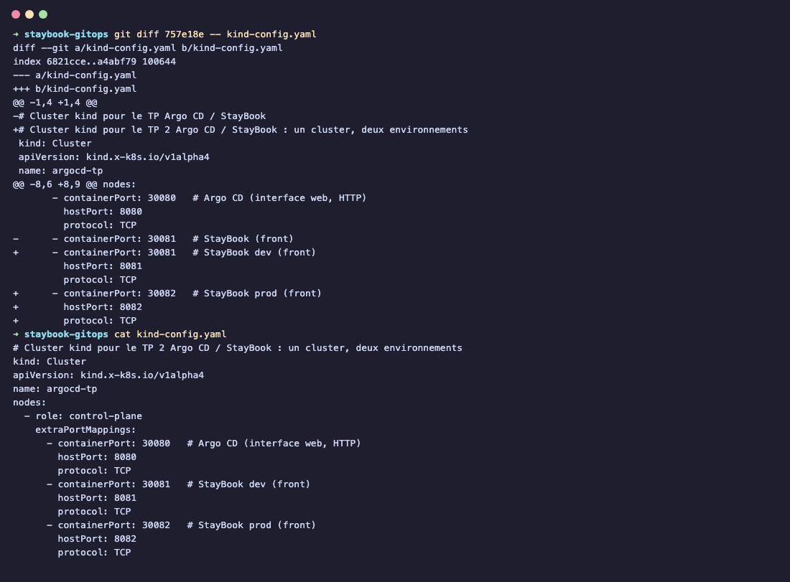

# Réponses — TP 2 : StayBook en production avec Argo CD

**Nom(s) :** Joseph Baert  
**Dépôt GitHub :** https://github.com/Sephoyo/staybook-gitops  

Les captures montrent les sorties réelles des commandes, lancées depuis le dépôt `staybook-gitops` (dossier [`captures/tp2/`](captures/tp2/)).


## Étape 1 — Repartir d'un cluster propre

### Question 1

_Comparez `kind-config.yaml` avec celui du TP 1. Qu'est-ce qui a été ajouté, et pourquoi la prod ne peut-elle pas réutiliser le NodePort 30081 de dev, alors qu'elle sera dans un autre namespace ?_



**Ajouté :** une troisième redirection de port, `containerPort: 30082` → `hostPort: 8082`, pour le front de **prod**. On a donc 8080 pour Argo CD, 8081 pour dev et 8082 pour prod. Les commentaires ont aussi été mis à jour (« StayBook dev »).

**Pourquoi pas 30081 pour la prod :** un **NodePort est une ressource du cluster entier, pas d'un namespace**. Le port est ouvert sur **chaque nœud**, par kube-proxy, et un port donné ne peut renvoyer que vers **un seul** Service. Les namespaces isolent les **noms** des objets, pas les ports réseau des nœuds. Un second Service qui demanderait `nodePort: 30081` serait refusé par l'API server (`provided port is already allocated`). Il faut donc un autre NodePort (30082), et donc une autre redirection kind (8082).


### Question 2

_Tout ce que vous aviez configuré dans Argo CD au TP 1 a disparu avec le cluster : le dépôt, les deux Applications, leur politique de sync. Listez ce qui, dans votre configuration Argo CD, vivait dans le cluster et non dans Git. À la fin de ce TP, cette liste sera réduite à deux éléments : lesquels, à votre avis ?_


Juste après la réinstallation, seul le dépôt (redéclaré à la main) existe, et aucune Application. Au TP 1, vivaient **uniquement dans le cluster** :
- la **déclaration du dépôt** et son **token** : le Secret `repo-…`, créé par `argocd repo add` ;
- les **Applications** `staybook` et `concierge`. Leur YAML était dans Git, mais c'est le `kubectl apply` manuel qui les créait. La **politique d'auto-sync** n'était prise en compte qu'après un nouvel apply à la main ;
- le **projet** `default`, créé automatiquement par l'installation ;
- le **mot de passe admin** (`argocd-initial-admin-secret`) et les sessions de la CLI ;
- l'**historique des syncs** (`argocd app history`) ;
- l'installation d'Argo CD elle-même. Sa recette est dans Git (`argocd-install/`), mais il faut l'appliquer à la main.

**À la fin du TP**, il ne restera que **deux éléments** hors de Git :
1. **le Secret du dépôt**, c'est-à-dire l'identifiant d'accès à GitHub : un mot de passe ne se commite pas ;
2. **l'Application racine `root`**, le seul `kubectl apply -f argocd/root.yaml`, l'amorce de l'App of Apps.

Tout le reste (projets, Applications, politiques de sync, contrôleur Sealed Secrets) sera décrit dans Git et créé par `root`. La clé privée Sealed Secrets restera elle aussi dans le cluster, mais exprès : elle ne doit jamais aller dans Git.


## Étape 2 — Un dépôt, deux environnements

### Question 3

_La base ne mentionne aucun namespace. Pourquoi est-ce voulu ? Qui le fixera, et à quel moment ?_


La base produit 16 objets (2 ConfigMap, 4 Deployment, 2 Secret, 6 Service, 2 StatefulSet) et **0** ligne `namespace:`.

C'est voulu : la base contient **ce qui est commun à tous les environnements**. Un namespace écrit en dur dans la base enverrait dev et prod au même endroit. On ne pourrait plus réutiliser la base pour deux environnements dans le même cluster.

C'est l'**overlay** qui le fixe, avec `namespace: staybook-dev` ou `namespace: staybook-prod` dans son `kustomization.yaml`. Kustomize l'ajoute alors à **tous** les objets au moment du **rendu**, quand on lance `kubectl kustomize` ou, dans le cluster, quand le **repo-server d'Argo CD** génère les manifests à chaque refresh, avant de les comparer au cluster. Le namespace de destination de l'Application (`--dest-namespace`) doit correspondre à cette valeur.


### Question 4

_Comparez `base/staybook/20-hotels-service.yaml` avec sa version du TP 1 : le bloc `DB_PASSWORD` a changé. Qu'est-ce qui a changé, et pourquoi était-ce indispensable avant la partie 3 ? Même question pour `RAG_URL` dans `30-gateway.yaml`._


**`DB_PASSWORD`** : au TP 1, le mot de passe était écrit **en clair dans le Deployment** (`value: "hotels"`). Au TP 2, il est **lu dans le Secret** `postgres-hotels`, clé `POSTGRES_PASSWORD`, via `valueFrom.secretKeyRef`.

C'était indispensable avant la partie 3 : on va remplacer le Secret en clair par un **SealedSecret chiffré**. Si le mot de passe restait aussi écrit en dur dans le Deployment, il resterait lisible dans Git et chiffrer le Secret ne servirait à rien. Avec `secretKeyRef`, le Secret devient la **seule source** du mot de passe : la base Postgres et le service qui s'y connecte lisent la même valeur. (Le `replicas: 2 → 1` du diff vient de la Q 8.1 du TP 1 : la base revient à 1, c'est l'overlay prod qui monte à 2.)

**`RAG_URL`** : `http://rag-service:3003` devient **`http://rag-service.concierge.svc.cluster.local:3003`**. Le concierge n'est plus dans le même namespace que le site : il est seul, dans le namespace `concierge`, et partagé par dev et prod. Un nom court ne se résout que dans le namespace du pod, il faut donc le **nom DNS complet** (on y revient en partie 2).


### Question 5

_Listez tout ce que `diff` montre entre dev et prod. Pour chaque différence, trouvez la ligne de `overlays/prod/kustomization.yaml` (ou du patch) qui la produit._


| Différence montrée par `diff` | Ligne qui la produit |
|---|---|
| `namespace: staybook-dev` devient `staybook-prod` sur **tous** les objets (16) | `namespace: staybook-prod` dans `overlays/prod/kustomization.yaml` |
| `nodePort: 30081` devient `30082` sur le Service `front` | `patches: - path: front-nodeport.yaml` (cible `kind: Service, name: front`) → dans le patch : `op: replace`, `path: /spec/ports/0/nodePort`, `value: 30082` |
| `replicas: 1` devient `2` sur `front`, `gateway`, `hotels-service`, `reservations-service` (4 Deployments) | le bloc `replicas:` ajouté en 1.3 (`- name: front / count: 2`, etc.) |

L'image n'apparaît pas dans le diff : les deux overlays ont le même bloc `images: - name: staybook-front / newTag: v1`.


### Question 6

_Dans le bloc `images:`, que désigne `name: staybook-front` ? Dans quel fichier de la base cette valeur apparaît-elle ? Si l'on ajoute `newName: ghcr.io/<login>/staybook-front` sous ce `name`, quelle ligne de quel manifest change ?_


`name: staybook-front` est le **nom de l'image à rechercher**, sans son tag, dans tous les conteneurs des manifests. Ce n'est pas le nom d'un Deployment. Kustomize remplace chaque `image:` dont le nom est `staybook-front`, quel que soit l'objet.

Cette valeur apparaît dans **`base/staybook/40-front.yaml`** : `image: staybook-front:v1`, dans le conteneur `front` du Deployment `front`.

Avec `newName: ghcr.io/Sephoyo/staybook-front` (et `newTag: <tag>`), c'est **la ligne `image:` du Deployment `front`** qui change dans le rendu : `image: staybook-front:v1` devient `image: ghcr.io/Sephoyo/staybook-front:<tag>`. **Le fichier de la base n'est pas modifié** : seul l'overlay change. C'est exactement ce que fera la CI en partie 4 : elle réécrira `newName`/`newTag` dans `overlays/dev/kustomization.yaml`, sans toucher à la base ni à la prod.


### Question 7

_Pourquoi ne pas avoir mis les deux StatefulSets PostgreSQL à 2 réplicas ? (Deux raisons : l'une concerne le volume, l'autre PostgreSQL lui-même.)_

1. **Le volume** : un StatefulSet crée **un PVC par réplica** grâce à `volumeClaimTemplates` (`data-postgres-hotels-0`, `data-postgres-hotels-1`). Le second pod démarrerait sur un **volume vide, à lui**, rejouerait le script d'init et aurait sa propre copie, différente, des données. Les deux pods ne partagent rien. Et le Service répartirait les requêtes entre eux au hasard : une réservation écrite sur l'un serait introuvable sur l'autre.
2. **PostgreSQL lui-même** : ce n'est pas un service sans état. Deux instances ne peuvent pas écrire sur les mêmes fichiers, et Postgres ne se réplique pas tout seul. Il faut une configuration **primaire / réplicas** (réplication en streaming, bascule en cas de panne), en général gérée par un opérateur (CloudNativePG, Zalando, Patroni). Augmenter `replicas` ne suffit pas.

Ajouter des réplicas ne marche que pour les services **sans état** (front, gateway, hotels, reservations), dont toutes les copies sont interchangeables.


### Question 8

_L'historique du TP 1 est toujours là, sous le nouveau commit. Pourquoi est-ce précieux pour un dépôt GitOps ? Citez une question qu'un auditeur pourrait poser et à laquelle `git log` répond._

```
593b5de feat: v2 — base/overlays, App of Apps, projets
757e18e docs: ajout du nom
3fa6d76 docs: preuves finales et historique complet (Q34)
ba401da docs: réponses 29, 33 et 34 avec les sorties réelles
ad3db13 Revert "feat: front v3 (image inexistante)"
d296892 feat: front v3 (image inexistante)
...
```

Dans un dépôt GitOps, **l'historique Git est l'historique des déploiements** : chaque état qu'a connu le cluster correspond à un commit. Le garder, c'est garder :
- la **traçabilité** : qui a changé quoi, quand, et pourquoi (le message de commit) ;
- la possibilité de **revenir** à n'importe quel état passé (`git revert`, ou redéployer un ancien commit) ;
- la capacité de **reconstruire** à l'identique l'environnement d'une date donnée ;
- les **preuves** pour un audit ou un post-mortem.

Repartir d'un dépôt neuf aurait effacé tout ça.

Exemple de question d'auditeur : *« Quelle version du front était en production le 24 novembre vers 15 h 07, et qui l'a déployée ? »* `git log` répond : `d296892 feat: front v3 (image inexistante)`, avec son auteur et sa date. On voit aussi qu'elle a été annulée une minute plus tard par `ad3db13 Revert …`.
